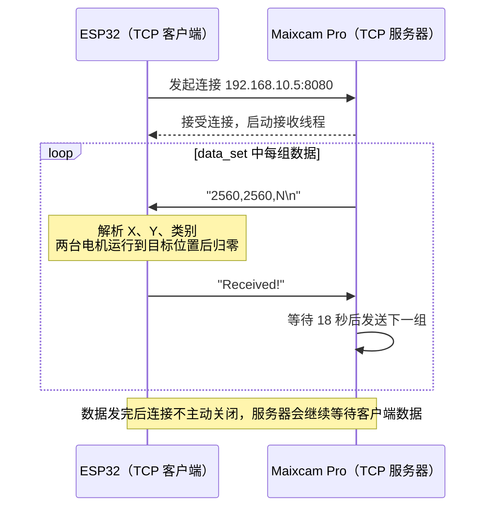

# Maixcam Pro + ESP32 通过 socket TCP 通信控制步进电机（完整教程）

> ⚠️ **代码已优化**：本 README 内联的 Arduino/Python 代码为**初版教程**示例。最新、可运行的源码以仓库根目录的 [`esp32_tcp_stepper/esp32_tcp_stepper.ino`](esp32_tcp_stepper/esp32_tcp_stepper.ino) 与 [`maixcam_tcp_server.py`](maixcam_tcp_server.py) 为准。
> 优化内容（非阻塞状态机、可靠行缓冲、像素→位置映射、双层重连、请求-应答握手、结构化 ACK 等）与深入研究路线见 [`OPTIMIZATION.md`](OPTIMIZATION.md)，通信协议规范见 [`protocol.md`](protocol.md)。

> 由两篇 CSDN 博客合并为单篇：
> - （一）ESP32 端：<https://blog.csdn.net/2401_84550508/article/details/144541721>（2024-12-17）
> - （二）Maixcam 端：<https://blog.csdn.net/2401_84550508/article/details/144566530>（2024-12-18）
>
> 本文由 CSDN 迁移至 GitHub 并合并为单篇。**已对原文中的 Wi-Fi 密码进行脱敏处理**（占位符 `<YOUR_WIFI_PASSWORD>`）。
>
> 源码文件：[esp32_tcp_stepper.ino](esp32_tcp_stepper/esp32_tcp_stepper.ino)、[maixcam_tcp_server.py](maixcam_tcp_server.py)

## 安全模型与运行限制（源码版）

> 本节描述仓库里**优化后的源码**（`esp32_tcp_stepper/esp32_tcp_stepper.ino` 与
> `maixcam_tcp_server.py`），与下面内联的初版教程代码不同。协议细节见 [protocol.md](protocol.md)。

- **⚠️ 默认无认证，局域网内任何人可驱动电机**：`maixcam_tcp_server.py` 的 `AUTH_TOKEN`
  默认为空字符串，此时服务器不做身份校验——任何能访问 8080 端口的设备都可以连接并控制
  机械臂。**仅限受信网络/实验台使用**。对外演示或生产环境请至少做到：
  - 两端设置相同的非空 `AUTH_TOKEN`（Python 服务器 + ESP32 `.ino`）。启用后 ESP32 连接成功
    会先发 `AUTH <token>\n`，首行格式不对/超时，服务器立即断开；
  - 用防火墙、独立热点或 VLAN 限制 8080 端口的来源 IP；
  - 保留物理断电 / 驱动器使能作为最终急停手段，不要只依赖软件。
- **单客户端**：同一时刻只允许一个 ESP32 连接，已有连接时新连接会被立即拒绝（服务器打印
  原因），避免多线程同时驱动同一台相机/机械臂。客户端断开或连续 ACK 超时会自动释放槽位。
- **严格解析**：ESP32 端要求整行字段数完全匹配（默认 4 个；`USE_CHECKSUM=true` 时 5 个），
  每个字段必须是十进制整数；`12,34,2junk`、尾随逗号、多余/缺失字段都会回 `ERR`，不再用
  `atol` 静默截断。Python 端发送前校验 `category ∈ [1,4]` 与像素坐标范围，坏指令不下发。
- **带序号 ACK，迟到回执不会错位**：下行 `x,y,cat,seq`，上行
  `ACK:STATUS:CAT:POS1:POS2:SEQ`；Maixcam 只接受序号匹配的回执，其余丢弃并记日志。
- **ESTOP / RESUME**：`ESTOP` 立即停止运动、关闭驱动器使能并回 ACK；`RESUME` 恢复接收指令。
  Python 侧提供 `send_estop(conn)` / `send_resume(conn)`，服务器被 Ctrl-C 关闭时也会尽力急停。
- **软限位**：目标脉冲必须在 `[0, TRAVEL_CIRCLES*CIRCLE_PULSES]` 内，越界回 `ERR` 且不运动。
- **不兼容旧客户端**：只发 3 个字段的旧脚本/旧固件会被拒绝；`USE_CHECKSUM` 默认关闭，
  开启时两端必须同时打开。迁移对照表见 [protocol.md](protocol.md) 第 10 节。

## 概述

通过 socket TCP 通信，实现 Maixcam 与 ESP32 之间相互发送信息，进而由 ESP32 控制步进电机带动机械臂运动。整体分工：

- **Maixcam Pro**：作为 **TCP 服务器**，识别物体坐标与类别后，向 ESP32 发送 `x,y,category` 形式的数据；
- **ESP32**：作为 **TCP 客户端**，连接 Maixcam 后接收数据并驱动两台步进电机移动到对应位置，完成后归零并反馈。

可拓展：Maixcam 识别物体坐标与种类 → 传输给 ESP32 → ESP32 控制步进电机带动机械臂到物体上方实现抓取。

## 硬件清单

| 器材 | 数量 | 作用 |
|------|------|------|
| ESP32 Dev Module | 1 | TCP 客户端，接收坐标并驱动电机 |
| Maixcam Pro | 1 | TCP 服务器，识别并下发目标位置 |
| 57 步进闭环驱动电机 | 2 | 带动机械臂运动 |
| 多路开关电源 | 1 | 给 ESP32 与驱动器独立供电 |
| 杜邦线 | 若干 | 接线 |

## 通信协议

- 数据格式：`像素X,像素Y,类别\n`（逗号分隔，换行符 `\n` 作为一帧结束标志）
- 示例：`2560,2560,1`
- 类别 `1~4` 对应四个预设位置；ESP32 收到后驱动两台电机到位并归零。

四个类别对应的目标位置（圈数，一圈按 3200 脉冲计）：

| 类别 | 目标位置 1 | 目标位置 2 |
|------|-----------|-----------|
| 1 | 0 | 0 |
| 2 | 0 | 6 圈 |
| 3 | 6 圈 | 6 圈 |
| 4 | 3 圈 | 3 圈 |

> 到位后两台电机统一回到零点，ESP32 回发一行 `Received!` 作为一次握手的结束。

## 通信流程



---

## 快速开始

1. **接线**：ESP32 与 57 步进闭环驱动器按代码里的引脚定义连接（使能 27/17、脉冲 25/5、方向 26/18），
   ESP32 与驱动器共用多路开关电源并共地。
2. **烧录 ESP32**：用 Arduino IDE 打开 [`esp32_tcp_stepper/esp32_tcp_stepper.ino`](esp32_tcp_stepper/esp32_tcp_stepper.ino)，
   安装 `AccelStepper` 库，把 `ssid`、`password` 改成自己的网络，`targetIP` 改成 Maixcam 的 IP，然后烧录。
3. **运行 Maixcam**：把 [`maixcam_tcp_server.py`](maixcam_tcp_server.py) 放到 Maixcam 上，
   确认脚本里的 `local_ip` 与本机一致，执行 `python3 maixcam_tcp_server.py`。
4. **看结果**：ESP32 串口监视器（115200）会打印连接状态与电机位置，Maixcam 端打印
   `Sent ...` 与 `Received!`。

> 两个 IP 必须对上：ESP32 的 `targetIP` 等于 Maixcam 的 `local_ip`。Maixcam 重新连 Wi-Fi 之后 IP 可能变化，
> 需要同步修改，否则 ESP32 连不上。

## 第一部分：ESP32 端（TCP 客户端 · C++ / Arduino）

### 1. 引入库

```cpp
#include <WiFi.h>
#include <WiFiClient.h>
#include <AccelStepper.h>
```

### 2. 定义电机引脚和参数

通过脉冲控制步进电机转动，一圈设为 3200 个脉冲。

```cpp
// 定义电机引脚
#define En_Pin2     17   // 电机1使能引脚
#define Stp_Pin2    5    // 电机1步进脉冲引脚
#define Dir_Pin2    18   // 电机1方向控制引脚
#define En_Pin1     27   // 电机2使能引脚
#define Stp_Pin1    25   // 电机2步进脉冲引脚
#define Dir_Pin1    26   // 电机2方向控制引脚

// 定义电机参数
#define CIRCLE_Puls        3200   // 电机旋转一圈的脉冲数
#define MAX_PIXEL_X        2560   // X轴最大像素点坐标
#define MAX_PIXEL_Y        2560   // Y轴最大像素点坐标
```

### 3. 创建 AccelStepper 对象

```cpp
AccelStepper stepper1(AccelStepper::DRIVER, Stp_Pin1, Dir_Pin1);  // 电机1
AccelStepper stepper2(AccelStepper::DRIVER, Stp_Pin2, Dir_Pin2);  // 电机2
```

### 4. 定义其它变量

```cpp
long targetPosition1 = 0;  // 初始化电机1位置
long targetPosition2 = 0;  // 初始化电机2位置
int category = 1;          // 垃圾种类整型变量，赋值为1
String receivedData = "";  // 用于存储接收到的数据
unsigned long lastDataProcessTime = 0;
const unsigned long dataProcessInterval = 10000;  // 数据处理间隔(ms)
```

### 5. Wi-Fi 设置

```cpp
// ⚠️ 以下 Wi-Fi 信息已从原文脱敏，请替换为你自己的网络
const char* ssid = "205-03";
const char* password = "<YOUR_WIFI_PASSWORD>";   // 原文为明文密码，已脱敏

const char* targetIP = "192.168.10.5";   // Maixcam 的 IP（TCP 服务器）
const uint16_t targetPort = 8080;

WiFiClient client;  // ESP32 作为 TCP 客户端
```

### 6. 初始化设置（setup）

连接指定 Wi-Fi，连接 TCP 服务器（Maixcam），配置电机参数（最大速度、初始速度、最大加速度），初始化电机位置，并用 LED 指示连接状态。

### 7. 处理 TCP 数据并控制重连（loop）

循环接收数据、以换行符 `\n` 为完整数据包标志进行处理，断线自动重连。

### 8. processReceivedData 函数

解析像素坐标与类别，驱动两台电机移动到计算出的位置，执行特定动作后归零，并通过串口反馈状态。

### 9. 完整代码（ESP32）

```cpp
#include <WiFi.h>
#include <WiFiClient.h>
#include <AccelStepper.h>

// 定义电机引脚
#define En_Pin2     17   // 电机1使能引脚
#define Stp_Pin2    5    // 电机1步进脉冲引脚
#define Dir_Pin2    18   // 电机1方向控制引脚
#define En_Pin1     27   // 电机2使能引脚
#define Stp_Pin1    25   // 电机2步进脉冲引脚
#define Dir_Pin1    26   // 电机2方向控制引脚

// 定义电机参数
#define CIRCLE_Puls        3200   // 电机旋转一圈的脉冲数
#define MAX_PIXEL_X        2560   // X轴最大像素点坐标
#define MAX_PIXEL_Y        2560   // Y轴最大像素点坐标
#define LED 2    // LED引脚

// 创建AccelStepper对象
AccelStepper stepper1(AccelStepper::DRIVER, Stp_Pin1, Dir_Pin1);  // 电机1
AccelStepper stepper2(AccelStepper::DRIVER, Stp_Pin2, Dir_Pin2);  // 电机2

// 定义变量
long targetPosition1 = 0;
long targetPosition2 = 0;
int category = 1;
String receivedData = "";
unsigned long lastDataProcessTime = 0;
const unsigned long dataProcessInterval = 10000;

// ⚠️ Wi-Fi 密码已从原文脱敏，请替换为你自己的网络
const char* ssid = "205-03";
const char* password = "<YOUR_WIFI_PASSWORD>";
const char* targetIP = "192.168.10.5";
const uint16_t targetPort = 8080;

WiFiClient client;

void setup() {
  pinMode(LED, OUTPUT);
  digitalWrite(LED, HIGH);
  delay(200);
  digitalWrite(LED, LOW);
  delay(200);
  digitalWrite(LED, HIGH);
  delay(200);
  digitalWrite(LED, LOW);

  Serial.begin(115200);
  delay(10);

  Serial.print("Connecting to ");
  Serial.println(ssid);
  WiFi.begin(ssid, password);
  while (WiFi.status() != WL_CONNECTED) {
    digitalWrite(LED, HIGH);
    delay(1000);
    digitalWrite(LED, LOW);
    delay(1000);
    Serial.print(".");
  }
  Serial.println("");
  Serial.println("WiFi connected");
  Serial.println(WiFi.localIP());

  pinMode(En_Pin1, OUTPUT);
  pinMode(En_Pin2, OUTPUT);
  digitalWrite(En_Pin1, 1);
  digitalWrite(En_Pin2, 1);

  stepper1.setMaxSpeed(CIRCLE_Puls * 1000);
  stepper1.setSpeed(CIRCLE_Puls * 1.0);
  stepper1.setAcceleration(CIRCLE_Puls * 6);
  stepper2.setMaxSpeed(CIRCLE_Puls * 1000);
  stepper2.setSpeed(CIRCLE_Puls * 1.0);
  stepper2.setAcceleration(CIRCLE_Puls * 6);

  stepper1.setCurrentPosition(0);
  stepper2.setCurrentPosition(0);

  delay(2000);

  Serial.print("Connecting to ");
  Serial.print(targetIP);
  Serial.print(":");
  Serial.println(targetPort);
  while (!client.connect(targetIP, targetPort)) {
    Serial.println("Connection to host failed");
    digitalWrite(LED, HIGH);
    delay(500);
    digitalWrite(LED, LOW);
    delay(500);
    Serial.print(".");
  }
  Serial.println("Connected to host");
  digitalWrite(LED, HIGH);
}

void loop() {
  if (client.connected()) {
    while (client.available()) {
      char c = client.read();
      Serial.write(c);
      receivedData += c;
      if (c == '\n') {
        unsigned long currentTime = millis();
        if (currentTime - lastDataProcessTime >= dataProcessInterval) {
          processReceivedData(receivedData);
          receivedData = "";
          lastDataProcessTime = currentTime;
        }
      }
    }
    delay(100);
  } else {
    Serial.println("Disconnected from host, trying to reconnect...");
    while (!client.connect(targetIP, targetPort)) {
      digitalWrite(LED, HIGH);
      delay(2000);
      digitalWrite(LED, LOW);
      delay(2000);
      Serial.print(".");
    }
    Serial.println("Reconnected to host");
    digitalWrite(LED, HIGH);
  }
}

void processReceivedData(String data) {
  String parts[3];
  int index = 0;
  int start = 0;
  for (int i = 0; i < data.length(); i++) {
    if (data.charAt(i) == ',') {
      parts[index] = data.substring(start, i);
      index++;
      start = i + 1;
    }
  }
  parts[index] = data.substring(start);

  int pixelValue_X = parts[0].toInt();
  int pixelValue_Y = parts[1].toInt();
  int receivedCategory = parts[2].toInt();

  if (pixelValue_X >= 0 && pixelValue_X <= MAX_PIXEL_X &&
      pixelValue_Y >= 0 && pixelValue_Y <= MAX_PIXEL_Y &&
      (receivedCategory == 1 || receivedCategory == 2 || receivedCategory == 3 || receivedCategory == 4)) {
    float circles_X = pixelValue_X / (float)MAX_PIXEL_X * 6;
    float circles_Y = pixelValue_Y / (float)MAX_PIXEL_Y * 6;
    long targetPosition1 = (long)(circles_X * CIRCLE_Puls);
    long targetPosition2 = (long)(circles_Y * CIRCLE_Puls);
    int category = receivedCategory;

    stepper2.runToNewPosition(targetPosition1);
    stepper1.runToNewPosition(targetPosition2);
    while (stepper1.distanceToGo() != 0 || stepper2.distanceToGo() != 0);

    Serial.print("1# Motor Current Position (pulses): ");
    Serial.println(stepper1.currentPosition());
    Serial.print("2# Motor Current Position (pulses): ");
    Serial.println(stepper2.currentPosition());

    delay(1000);
    if (stepper1.distanceToGo() == 0 && stepper2.distanceToGo() == 0) {
      if (receivedCategory == 1) {
        targetPosition1 = 0;
        targetPosition2 = 0;
        stepper1.runToNewPosition(targetPosition1);
        stepper2.runToNewPosition(targetPosition2);
        Serial.println("Both Motors moved to 1 position.");
      } else if (receivedCategory == 2) {
        targetPosition1 = 0;
        targetPosition2 = (long)(6 * CIRCLE_Puls);
        stepper1.runToNewPosition(targetPosition1);
        stepper2.runToNewPosition(targetPosition2);
        Serial.println("Both Motors moved to 2 position.");
      } else if (receivedCategory == 3) {
        targetPosition1 = (long)(6 * CIRCLE_Puls);
        targetPosition2 = (long)(6 * CIRCLE_Puls);
        stepper1.runToNewPosition(targetPosition1);
        stepper2.runToNewPosition(targetPosition2);
        Serial.println("Both Motors moved to 3 position.");
      } else if (receivedCategory == 4) {
        targetPosition1 = (long)(3 * CIRCLE_Puls);
        targetPosition2 = (long)(3 * CIRCLE_Puls);
        stepper1.runToNewPosition(targetPosition1);
        stepper2.runToNewPosition(targetPosition2);
        Serial.println("Both Motors moved to 4 position.");
      }
      stepper1.runToNewPosition(0);
      stepper2.runToNewPosition(0);
      Serial.println("Both Motors moved back to zero position.");
    }
    client.println("Received!");
  }
}
```

---

## 第二部分：Maixcam 端（TCP 服务器 · Python）

### 1. 导入必要模块

```python
import socket
import threading
import time
```

### 2. 服务器配置

`local_ip` 和 `local_port` 定义了服务器监听的 IP 地址和端口。`data_set` 是一个包含四个字符串的列表，每个字符串由三个数字组成，以逗号分隔。

```python
local_ip = "192.168.10.5"
local_port = 8080

# 数据集，包含四个由三个数字构成的组合
data_set = [
    "2560,2560,1",
    "2560,2560,2",
    "2560,2560,3",
    "2560,2560,4",
]
```

> 这里为了方便调试只是简单列了四组数据，实际上可以用 Maixcam 的识别功能进行拓展，如：识别完物体种类、尺寸以及坐标后，发送给 ESP32，ESP32 控制电机驱动机械臂实现对物体的精准抓取（多个物体可以考虑优先级）。

### 3. 接收线程函数 receiveThread

负责处理来自单个客户端的连接：遍历 `data_set` 逐条发送；每条发送后等待 18 秒再尝试从客户端接收数据；若收到数据则打印，否则继续发送下一条；异常则打印错误；最后关闭连接。

```python
def receiveThread(conn, addr):
    try:
        for message in data_set:
            # 发送数据给客户端
            conn.sendall(message.encode('utf-8') + b"\n")
            print(f"Sent {message} to {addr}")
            # 等待一段时间再尝试接收来自客户端的数据
            time.sleep(18)
            # 尝试接收来自客户端的数据
            client_data = conn.recv(1024)
            if client_data:
                print(f"Received {client_data.decode('utf-8')} from {addr}")
                print("Received!")
            else:
                print("No data received from client, continuing to send next message.")
    except Exception as e:
        print(f"Error in communication with {addr}: {e}")
    finally:
        print(f"Client {addr} disconnected")
        conn.close()
```

### 4. 服务器设置和监听

```python
ip_port = (local_ip, local_port)
sk = socket.socket(socket.AF_INET, socket.SOCK_STREAM)
sk.setsockopt(socket.SOL_SOCKET, socket.SO_REUSEADDR, 1)
sk.bind(ip_port)
sk.listen(50)
```

### 5. 主循环

无限循环等待客户端连接；每接受一个新的客户端连接，起一个守护线程运行 `receiveThread`。

```python
print("Server is listening on", ip_port)
while True:
    conn, addr = sk.accept()
    print(f"Client {addr} connected")
    t = threading.Thread(target=receiveThread, args=(conn, addr))
    t.daemon = True
    t.start()
```

### 6. 完整代码（Maixcam）

```python
import socket
import threading
import time

local_ip = "192.168.10.5"
local_port = 8080

data_set = [
    "2560,2560,1",
    "2560,2560,2",
    "2560,2560,3",
    "2560,2560,4",
]

def receiveThread(conn, addr):
    try:
        for message in data_set:
            # 发送数据给客户端
            conn.sendall(message.encode('utf-8') + b"\n")
            print(f"Sent {message} to {addr}")
            # 等待一段时间再尝试接收来自客户端的数据
            time.sleep(18)
            # 尝试接收来自客户端的数据
            client_data = conn.recv(1024)
            if client_data:
                print(f"Received {client_data.decode('utf-8')} from {addr}")
                print("Received!")
            else:
                print("No data received from client, continuing to send next message.")
    except Exception as e:
        print(f"Error in communication with {addr}: {e}")
    finally:
        print(f"Client {addr} disconnected")
        conn.close()

ip_port = (local_ip, local_port)
sk = socket.socket(socket.AF_INET, socket.SOCK_STREAM)
sk.setsockopt(socket.SOL_SOCKET, socket.SO_REUSEADDR, 1)
sk.bind(ip_port)
sk.listen(50)

print("Server is listening on", ip_port)
while True:
    conn, addr = sk.accept()
    print(f"Client {addr} connected")
    t = threading.Thread(target=receiveThread, args=(conn, addr))
    t.daemon = True
    t.start()
```

---

## 注意事项（两端通用）

1. 电机接电前应按一下 ESP32 的 boot 键，且不要在开始通信后才给电机通电，防止电机接收到脉冲信号后转动，带动组件与其它组件发生冲突；
2. Maixcam 在重新连接 Wi-Fi 以传输代码时，会出现 IP 改变的情况，需同步修改目标 IP（ESP32 端 `targetIP` / Maixcam 端 `local_ip`），否则 ESP32 将无法连接到 Maixcam；
3. 服务器在发送完 `data_set` 中的所有数据后，不会主动关闭连接；若客户端未发送数据或关闭连接，服务器将无限期等待下一个 `recv`，可能导致资源占用；
4. 代码未处理客户端发送的数据内容，仅检查是否收到；按实际需求应添加响应处理逻辑（优化后的源码已改用严格解析 + 带序号 ACK）；
5. 服务器未实现并发控制或数据完整性检查；硬编码 IP/端口限制了灵活性（优化后的源码已加入单客户端限制、序号校验与可选认证，见上文「安全模型与运行限制」）。

## 常见问题

**ESP32 一直连不上 Maixcam**
先核对两边 IP：ESP32 的 `targetIP` 必须等于 Maixcam 的 `local_ip`，再确认在同一网段、8080 端口未被占用。
Maixcam 重新连 Wi-Fi 传代码后 IP 会变，这是最常见的原因。

**电机在通信建立后才上电，容易出现抖动或撞件**
上电顺序要注意：先按一下 ESP32 的 boot 键，再给电机通电。若先通电、后开始通信，电机可能在上电瞬间
收到脉冲而转动，带动机械结构与其它部件相撞。

**服务器发送完 data_set 后卡住不结束**
代码在发完所有数据后不会主动关闭连接。如果客户端既没有回数据也没有断开，服务器会一直阻塞在 `recv`，
需要的话可以自行加超时或主动关闭。

**数据收到了但电机不动**
检查驱动器使能引脚（`En_Pin1`/`En_Pin2`）的电平是否符合你所用驱动器的定义，以及 ESP32 与驱动器是否共地。

## 总结

以上就是 Maixcam 与 ESP32 通过 TCP 通信控制步进电机的完整实现：ESP32 作为 TCP 客户端驱动步进电机，Maixcam 作为 TCP 服务器下发坐标与类别。本文合并了原 CSDN 的（一）ESP32 端与（二）Maixcam 端两篇。如有错误，敬请批评指正！
